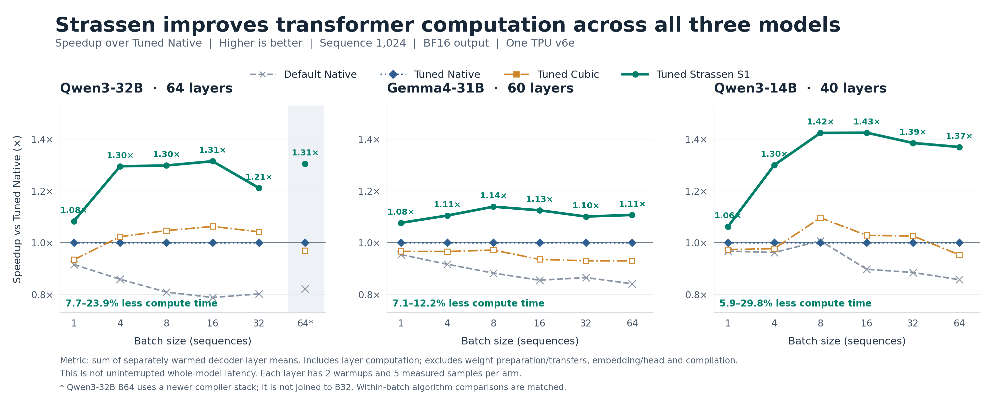
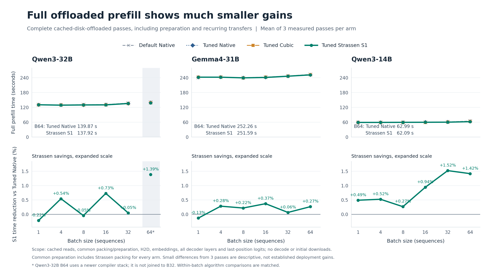
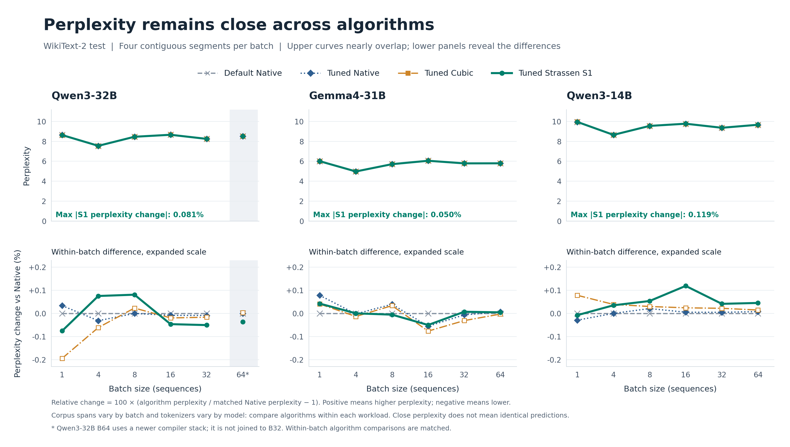

# Three LLM experiments: computation, full runtime and perplexity

Offline analysis of the completed Qwen3-32B, Gemma4-31B and Qwen3-14B studies.
All use one TPU v6e, sequence length 1,024, batches 1/4/8/16/32/64 and BF16
output. All four algorithms are shown, with Tuned Strassen S1 highlighted.
No new TPU experiment was run and no earlier result was overwritten.

**The clearest result is a consistent reduction in resident transformer
computation time. The full offloaded pipeline gains much less, while
perplexity remains close to the matched Native result.**

## 1. Transformer computation

[Vector PDF](figures/01_transformer_speedup.pdf) · [Editable SVG](figures/01_transformer_speedup.svg)

Each point is Tuned Native time divided by the algorithm's time. A value of
1.4× means approximately 28.6% less time, not 40% less time. The denominator
and numerator are sums of independently warmed decoder-layer means, including
attention, normalization and residual computation. They exclude weight
preparation/transfers, embeddings, final norm/head and compilation. This is
not uninterrupted whole-model latency. Each layer has two warmups and five
measured samples per arm.

| Model | S1 time reduction vs Tuned Native, all batches | B4–B64 only | B64 resident time saved |
|---|---:|---:|---:|
| Qwen3-32B | 7.70–23.95% | 17.46–23.95% | 1,827.97 ms |
| Gemma4-31B | 7.14–12.22% | 9.20–12.22% | 809.81 ms |
| Qwen3-14B | 5.86–29.83% | 23.08–29.83% | 1,169.12 ms |

Strassen has the lowest resident total among all four measured algorithms
in **18 of 18 model/batch combinations**. These are descriptive comparisons
of the recorded means; they are not 18 independent replicated experiments.
The resident figure does not show confidence intervals. Layer bootstrap
intervals remain in the original reports and are not confidence intervals
from independently repeated whole-model execution.

## 2. Full offloaded prefill

[Vector PDF](figures/02_full_offloaded_runtime.pdf) · [Editable SVG](figures/02_full_offloaded_runtime.svg)

Upper panels show actual seconds for a complete serialized prefill pass,
averaged over three measured passes after one warmup. Lower panels expand
the percentage difference between Strassen and Tuned Native; positive means
Strassen used less time. Upper panels share a zero-based seconds axis.

This scope includes cached checkpoint reads, common weight preparation and
packing, recurring host-to-device transfers, embeddings, all decoder layers
and last-position logits. It excludes initial network downloads, compilation
and autoregressive decode. The common loader performs Strassen preparation
for every arm; this is not an independently optimized Native serving system.

| Model | B64 Tuned Native | B64 Strassen | Time saved | Percentage saved |
|---|---:|---:|---:|---:|
| Qwen3-32B | 139.869 s | 137.924 s | 1.945 s | 1.39% |
| Gemma4-31B | 252.262 s | 251.593 s | 0.669 s | 0.27% |
| Qwen3-14B | 62.986 s | 62.092 s | 0.894 s | 1.42% |

Strassen has a lower offloaded mean than Tuned Native in 15 of 18 workloads.
The exceptions are Qwen3-32B B1/B8 and Gemma4-31B B1. Differences are generally
small and many sample ranges overlap; three passes do not establish a broad
deployment speedup. Every original pass is retained in `plot_data.json` and
the input snapshots. The resident and offloaded measurements have different
execution procedures and should not be subtracted to claim an exact transfer
overhead or an exact compute fraction.

## 3. Perplexity

[Vector PDF](figures/03_perplexity.pdf) · [Editable SVG](figures/03_perplexity.svg)

Upper panels show absolute WikiText-2 test perplexity for all four arms.
The curves nearly overlap. Lower panels show
`100 × (algorithm PPL / matched Native PPL − 1)` to reveal the small differences.
Lower perplexity is better, but these small signed changes should not be
interpreted as evidence that rounding improves model quality.

| Model | Largest absolute S1 relative PPL change over six batches |
|---|---:|
| Qwen3-32B | 0.0811% |
| Gemma4-31B | 0.0501% |
| Qwen3-14B | 0.1191% |

Every algorithm's perplexity differs from its matched Native baseline by
less than 0.20% across all 72 recorded algorithm/workload results. All
registered predictive-quality gates passed. Close perplexity does not mean
identical logits or predictions; the full error measurements remain in the
original studies. This figure intentionally focuses on perplexity.

Different batches consume different corpus spans, so the rise/fall of
absolute perplexity across batch sizes is not a controlled effect of batching.
Tokenizers also differ across model families; the absolute values are not
a cross-model quality ranking. The valid comparison here is between algorithms
within each workload.

## Observations supported by these results

1. **The compute benefit is consistent across two model families.** All three
   models and all six batches favor S1 in the resident-layer total. This
   supports the application role of the LLM studies: the benefit survives
   real weights, propagated activations and surrounding transformer work.
   It does not isolate reduced multiplication count from fusion and scheduling.

2. **Batching helps, but the relative benefit does not grow indefinitely.**
   B1 gains are 5.86–7.70%; B4 and above generally benefit more. The largest
   relative savings occur at B16 for Qwen3-32B and Qwen3-14B, and at B8 for
   Gemma4-31B. Each batch was independently tuned. This is evidence against
   presenting savings as a monotonic function of batch size or token count.

3. **Parameter count alone does not predict the gain.** Qwen3-14B reaches
   29.83% less resident time, compared with 23.95% for Qwen3-32B and 12.22%
   for Gemma4-31B. Projection shapes, layer composition, selected tiles and
   the share of time spent in modified sites are plausible explanations,
   not mechanisms isolated by this aggregate comparison. Qwen3-32B also has
   a software-stack difference described below.

4. **The offloaded experiment exposes a separate systems bottleneck.**
   Much of each pass is recurring loading/preparation/transfers rather than
   the warmed decoder computation targeted by the kernels. An informative
   observation is that Qwen3-14B S1 takes 59.011 s at B1 and 62.092 s at B64
   while processing 64 times as many input tokens. Gemma4 S1 rises from
   242.330 s to 251.593 s. This is consistent with amortizing substantial
   per-pass costs; it does not by itself establish production serving throughput.

5. **The speed benefit is not accompanied by a material PPL shift in this test.**
   The maximum absolute S1 change is 0.1191%. This is useful application
   evidence alongside the shape study's arithmetic diagnostics, while remaining
   specific to the evaluated corpus, model computation and precision contract.

## Compiler boundary and interpretation

Qwen3-32B B1–B32 used JAX/jaxlib 0.7.2 and libtpu 0.0.21.1. Its B64 run used
JAX/jaxlib 0.11.2 and libtpu 0.0.48 after a compiler failure. Qwen3-32B B64
is therefore shaded, marked with an asterisk and not connected to B32 in
every figure. Every within-batch algorithm comparison is matched.
All Gemma4-31B and Qwen3-14B batches use the newer stack.

The results demonstrate current single-device compute benefits under these
protocols. They do not establish distributed scaling, decode latency,
fully resident whole-model serving speed, or gains from hypothetical future
hardware. The shape kernels/tuner and parent-derived fused LLM kernels are
distinct implementations; their measurements should not be pooled.

## Sources and reproduction

- [Benchmark 1: Qwen3-32B](../llm_benchmark_1_qwen3_32b/README.md)
- [Benchmark 2: Gemma4-31B](../llm_benchmark_2_gemma4_31b/summaries/completed_20261017_v001/README.md)
- [Benchmark 3: Qwen3-14B](../llm_benchmark_3_qwen3_14b/summaries/completed_20261017_v001/README.md)

`inputs/` contains exact snapshots of those published JSON summaries, with
source paths, SHA-256 hashes and repository revision in `inputs/manifest.json`.
`plot_data.json` holds all 18 workloads × four algorithms, normalized metrics,
full raw prefill samples, perplexity and compiler identities used by the plots.
`plot_results.py` verifies source hashes, workload completeness, quality gates
and arithmetic means before rendering. It uses Matplotlib 3.10.3 and NumPy 2.2.6.

From this directory, run `python plot_results.py --output /tmp/llm-figures/figures`
to regenerate into a new directory. Preserve the committed output snapshot.
All three figures are supplied as high-resolution PNG, vector PDF and SVG.
